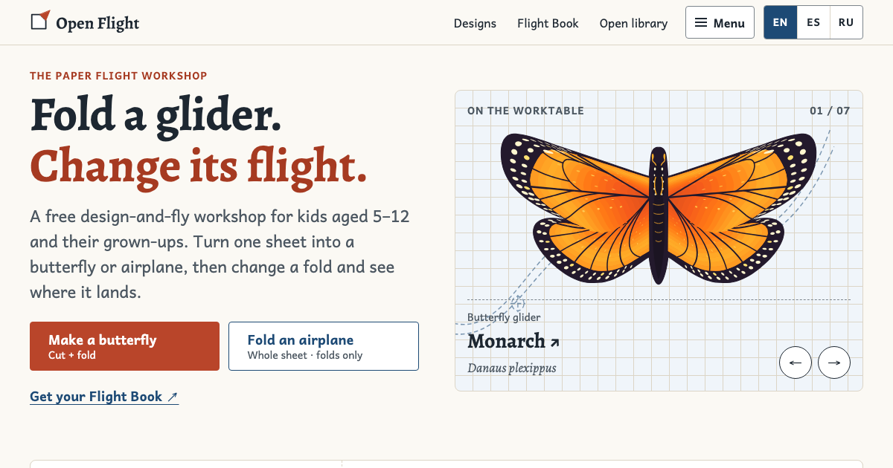

# Open Flight

Make a paper glider with a child or a classroom, then change one fold and see where it lands. The free workshop runs in your browser. You can save a butterfly design on your device, download its editable source, or start with plain paper and a folding guide. [Open the workshop](https://kevinmamaqi.github.io/open-flight/?lang=en) · [По-русски](README.ru.md) · [Español](README.es.md)

Read a Flight Book page by page. Pick a flyer to try new colors, then choose whether to feature it on the cover or include its pattern. The interactive world map shows where a real butterfly lives or where an aircraft first flew. The printed field notes credit museums and wildlife institutions and include stories of Yuri Gagarin and John Glenn. Choose A4 or US Letter, measure the 50 mm line on page 2 and print the patterns at actual size. [Open the Flight Book](https://kevinmamaqi.github.io/open-flight/book.html?lang=en) · [Atlas sources and photo credits](guides/flight-book-origins.md) · [Artwork and font credits](guides/flight-book-art.md)

The free classroom guide calculates copies and page ranges for teams starting with 30 learners in pairs. Print the guide, share the book PDF from your phone where supported, or send it with the copyable instructions to a print shop. Print one-sided at actual size (100%) and check the 50 mm line in the book before making the class copies. [Classroom and print shop](https://kevinmamaqi.github.io/open-flight/classroom.html?lang=en)

The butterfly studio offers tabbed wings and a folded body on the same worktable. The motor lab includes references, open bench files and an unpowered printable mount. [Butterfly studio](https://kevinmamaqi.github.io/open-flight/studio.html?lang=en) · [Motor lab](https://kevinmamaqi.github.io/open-flight/motor.html?lang=en)

| Make | Start with | What to change |
| --- | --- | --- |
| Folded-body Monarch, blue morpho or swallowtail | A color or low-ink K1 sheet, a ruler, scissors and a small rounded clip | Match the wingtips, pinch the double body and open the wings on a table. Change the span and palette. [Build K1](https://kevinmamaqi.github.io/open-flight/studio.html?construction=k1&species=monarch&lang=en) |
| Original tabbed Monarch, blue morpho or swallowtail | A printed sheet, scissors and a small blunt paper clip | Wingspan, colors and two independent back tabs. Follow the cut outline, raise the wings and compare the landing marks. |
| A Boeing 747, Douglas DC-3, Tupolev Tu-144 or Ilyushin Il-62 inspired airplane | One whole sheet of A4 or US Letter paper | Choose a body fold, wingtip height and livery. Follow the illustrated stages. A printer is optional. |

The three butterflies draw on photographs of real species. The four airplane patterns are original interpretations of civil aircraft, with illustrated guides linking a full-size feature to the paper fold. The 3D flight view and three-gate circuit illustrate predictions you can compare with an actual launch. Each starter sheet includes a calibration ruler. Print at actual size and measure 50 mm on a butterfly or 20 mm on an airplane. [Field references](https://kevinmamaqi.github.io/open-flight/references.html?lang=en) · [60 PDF editions and three offline lessons](docs/library/) · [Family lesson](guides/paper-flight-lesson.md) · [Version 0.8.0](https://github.com/kevinmamaqi/open-flight/releases/tag/v0.8.0)

## Run it yourself

The `docs/` folder contains the ready-to-serve site. From this repository run `python3 -m http.server 8000 --directory docs`, then visit `http://localhost:8000`. Artwork, fonts, fold instructions and 3D assets are served with the site. The complete workshop ZIP includes the book builder and classroom guide. Unzip it, run `python3 -m http.server 8000` in the extracted directory, then open `http://localhost:8000/book.html?lang=en` or `http://localhost:8000/classroom.html?lang=en`. Downloaded PDFs and standalone lessons open directly. [Workshop and print-library downloads](https://github.com/kevinmamaqi/open-flight/releases/tag/v0.8.0)

For the local workspace with revision history shared across HTTP and MCP, install Node 24 or later, run `npm ci`, then `npm run editor -- --workspace ./local/studio --port 4180`. The terminal reports the path to a private launch file. Open it to connect the studio to that workspace. For command-line clients see the public contracts and integration example. [HTTP routes](api/openapi.json) · [MCP tools](api/mcp-tools.json) · [Integration example](examples/agent-client/journey.ts)

## Edit or contribute

The butterfly curves, colors and measurements live in `packages/geometry`. The whole-sheet airplane models live in `apps/editor/assets/planes`. Run `npm test` and `npm run typecheck` to check your changes. With Bun installed, `npm run build:site` regenerates the browser engine, starter sheets and static site. [Wing geometry](packages/geometry/) · [Folded body and print generator](packages/folded-butterfly/) · [Airplane models](apps/editor/assets/planes/) · [Terms and credits](NOTICES.md)

Grown-ups can send a short flight observation or identify a confusing fold. Include the model, paper size, setting and what happened. Children’s names, faces and contact details are unnecessary. A powered version is a research direction. The current designs are hand-launched. [Send a flight note](https://github.com/kevinmamaqi/open-flight/issues/new?template=flight-report.yml) · [Powered roadmap](https://kevinmamaqi.github.io/open-flight/references.html?lang=en#powered)
