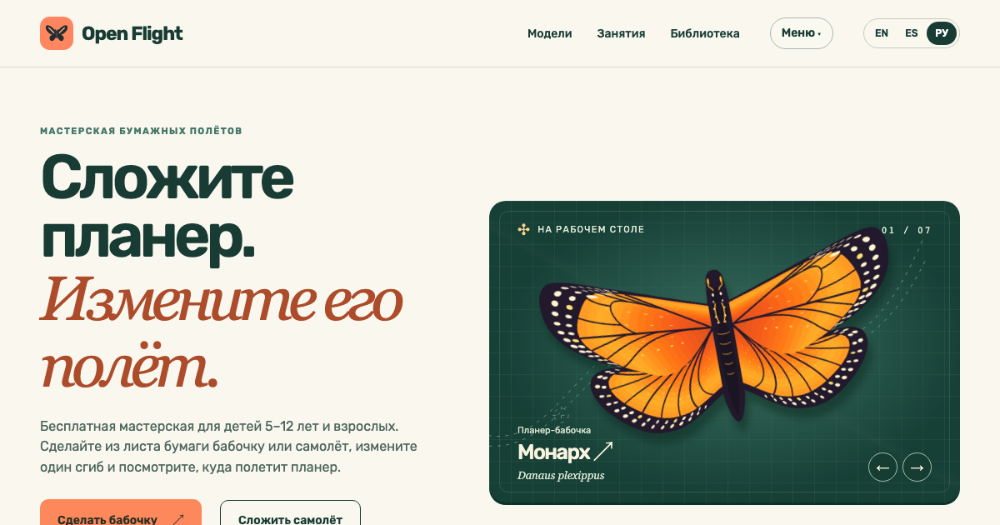

# Open Flight · Мастерская бумажных полётов

Бесплатная мастерская для детей 5–12 лет и взрослых. Выберите планер, измените сгиб и посмотрите, куда он прилетит. Мастерская работает в браузере. Бабочку можно сохранить на своём устройстве. Самолёт можно сложить из обычного листа по картинкам. [Открыть мастерскую](https://kevinmamaqi.github.io/open-flight/ru.html) · [English](README.md) · [Español](README.es.md)

| Модель | Что приготовить | Что можно изменить |
| --- | --- | --- |
| Монарх, голубой морфо или махаон | Распечатка, ножницы и небольшая скрепка с закруглёнными концами | Размах, окраску и наклон двух задних язычков. Сделайте прогноз, запустите планер и отметьте место посадки. |
| Самолёт по мотивам Boeing 747, Douglas DC-3, Ту-144 или Ил-62 | Целый лист А4 или US Letter | Глубину сгиба корпуса, высоту законцовок и раскраску. Картинки показывают каждый этап. Принтер необязателен. |

Печатайте в натуральную величину. Контрольный отрезок должен быть 50 мм у бабочек и 20 мм у самолётов. Трёхмерная траектория и полёт через трое ворот показывают возможный ход полёта. Чтобы проверить его, запустите настоящую бумажную модель. У каждой модели есть редактируемый исходник. [42 PDF и три занятия для работы без интернета](docs/library/) · [Семейное занятие](guides/paper-flight-lesson.md) · [Версия 0.4.0](https://github.com/kevinmamaqi/open-flight/releases/tag/v0.4.0) · [Первоисточники и авторы](https://kevinmamaqi.github.io/open-flight/references.html?lang=ru)

## Запуск на своём компьютере

В каталоге `docs/` лежит готовый сайт. Из корня проекта выполните `python3 -m http.server 8000 --directory docs` и откройте `http://localhost:8000`. Для локального редактора с историей и доступом по HTTP и MCP установите Node 24 или новее, выполните `npm ci`, затем `npm run editor -- --workspace ./local/studio --port 4180` и откройте файл запуска, путь к которому появится в терминале. [HTTP](api/openapi.json) · [MCP](api/mcp-tools.json)

Взрослые могут рассказать, какой сгиб вызвал затруднение или как прошёл запуск. Достаточно указать модель, бумагу, настройку и результат. Для будущей мастерской мы изучаем съёмный мотор. [Обратная связь](https://github.com/kevinmamaqi/open-flight/issues/new?template=flight-report.yml) · [План исследований](https://kevinmamaqi.github.io/open-flight/references.html?lang=ru#powered) · [Лицензии](NOTICES.md)
